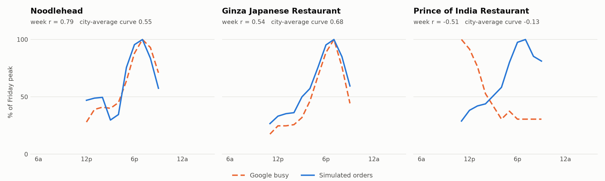

# Calibration: how close is the simulated city to the real one?

The simulator predicts orders hour by hour.
Google Maps shows how busy 64 real restaurants in the sim area are, hour by hour, for every day of the week.
We fit the simulator to the hourly shape of most of those places, then test it on places it never saw.

## Method

1. Target: for each of the 64 places, Google "popular times" on every open day-hour (relative to that place's own weekly peak).
2. Model: expected orders per place per day-hour in today's city (no concept), computed exactly from the same choice model the simulator runs.
3. Fit: the hourly order curve of each resident segment, the 7 day factors, and how much people want each cuisine at each time of day (morning, lunch, afternoon, dinner, late), on 51 places (80%, fixed split by seed).
4. Score: Pearson correlation between simulated and Google shapes over each held-out place's open hours of the week, on the other 13 places.
5. Compare: the hand-set model before calibration, and a naive baseline that gives every place the city-wide average Google curve.

## Results (13 held-out places)

| Model | Median r, held out | Median r, train |
|---|---|---|
| Calibrated simulator | **0.54** | 0.59 |
| Naive: city-average curve for every place | 0.44 | 0.39 |
| Hand-set simulator, before calibration | 0.32 | - |

The calibrated simulator beats the naive curve on 9 of 13 held-out places.
Its held-out median is 0.10 above the naive curve's.
Every prediction carries the held-out median in `calibration.heldOutCorrelation`.

Secondary check, not fitted: the simulated weekly volume of each place ranks like its Google review count with a Spearman correlation of 0.45 (all 64 places).



The chart shows the best, the median and the worst held-out place, so it does not show only wins.
Each panel is Friday only, and both curves are scaled to their own Friday peak.
The label shows the correlation over the whole week.

| Held-out place | Calibrated r | City-average r | Hand-set r |
|---|---|---|---|
| Noodlehead | 0.79 | 0.55 | 0.66 |
| Girasole | 0.74 | 0.69 | 0.54 |
| Dad's Dog & Burger | 0.71 | 0.47 | 0.32 |
| El Jefes Taqueria | 0.69 | 0.51 | 0.44 |
| How Lee | 0.66 | 0.61 | 0.41 |
| Bruegger's Bagels | 0.56 | 0.28 | 0.63 |
| Ginza Japanese Restaurant | 0.54 | 0.68 | 0.27 |
| Dunkin' | 0.34 | 0.44 | 0.33 |
| Pastoli's | 0.28 | 0.02 | 0.29 |
| Panera Bread | 0.14 | 0.06 | 0.02 |
| Noodles & Company | 0.10 | 0.11 | 0.00 |
| Omar's Halal Grill | 0.03 | 0.02 | 0.14 |
| Prince of India Restaurant | -0.51 | -0.13 | -0.25 |

## What the fit changed

- The biggest gain came from time-of-day taste per cuisine.
  Before, every place shared the same hourly demand, so a bagel shop peaked at dinner like everyone else.
  Now sandwiches lean to lunch, and almost nothing but breakfast and coffee sells before 11 AM.
  The concept gets the same rule, so a breakfast concept and a late-night concept get different days.
- The hour curves gained a lot of afternoon weight (2 PM to 5 PM) for every segment.
  Undergrads lost about half of their late-night weight.
  Dinner (6 PM to 7 PM) stays the peak.
- A 3 x 3 grid over the logit scale (1.0 to 1.5) and the travel-time scale (0.75 to 1.25) moved the training score by less than 0.01.
  Both stay at their hand-set values.
- The fixture concept now gets about 57 orders on a Friday (it got 67 before), with a real dinner peak.
  All sanity checks still pass.

## Honest limits

- Google shows foot traffic, not delivery.
  Dine-in lunch crowds and delivery dinners peak at different times, so a perfect delivery model would not reach r = 1 here.
- The worst place, Prince of India, runs a lunch buffet.
  Its Google peak is 11 AM, and the simulator still puts its peak at dinner.
  Nothing in the model knows about buffets.
- 13 held-out places is a small test.
  One more or one fewer good place moves the median by a few hundredths.
- The population is hand-set per area, not Census data.
  The fit can only bend hour curves and tastes, so errors in who lives where stay in.
- Only cuisines with Google data get a fitted time-of-day row (20 of 24).
  The others keep the prior: no sales before 11 AM unless breakfast or coffee.
- The correlation measures shape, not volume.
  It says when a place is busy, not how many orders it gets.

## Rerun

```bash
bun scripts/calibrate/calibrate.ts                          # about 35 s, writes data/city/calibration.json
uv run --with matplotlib python scripts/calibrate/chart.py  # writes docs/calibration-friday.png
bun server/src/sim/sanity.ts                                # all checks must pass
```

The split and the fit are fixed by a seed, so a rerun gives the same numbers.
